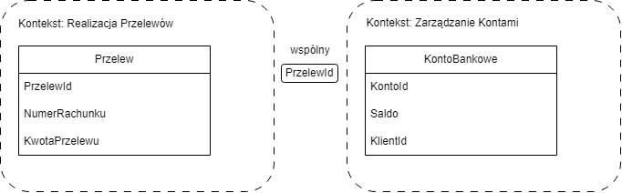

# Opis Zadania 1 - Domain Driven Design (DDD)

## 1. Opis Zadania
Celem zadania jest zamodelowanie bezpiecznej aplikacji bankowej odpowiedzialnej za przelewy bankowe z wykorzystaniem Domain Driven Design. Wyodrębniłem dwa konteksty ograniczone, czyli zarządzanie kontami oraz realizację przelewów. Aplikacja unika błędów logiki biznesowej oraz niepoprawnych stanów obiektów poprzez wymuszenie niezmienników biznesowych w korzeniach agregatów i walidację obiektów wartości (VO).

## 2. Model Domeny

## 3. Założenia i Opis Elementów Modelu

### Konteksty Ograniczone (Bounded Contexts) i ACL
* **Kontekst Realizacji Przelewów:** Odpowiada za realizację przelewów. Przechowuje numer rachunku, kwotę.
* **Kontekst Zarządzania Kontami:** Odpowiada za prowadzenie rachunków bankowych dla konkretnych klientów. Przechowuje ID klienta, saldo i tym podobne.
* **Warstwa Antykorupcyjna (ACL):** Stoi na wejściu do kontekstu Zarządzania Kontami. Tłumaczy niezaufane żądania przychodzące z realizacji przelewów na typy domenowe, na przykład "polecenie obciążenia".

### Agregaty, Encje i Obiekty Wartości (Value Objects)

#### 1. Agregat Przelew (Kontekst Realizacji Przelewów)
* **`Przelew` (Encja-Korzeń):** Posiada tożsamość `PrzelewId`. Zarządza stanem przelewu i wymusza niezmienniki biznesowe.
* **`NumerRachunku` (Value Object):**
  * *Rozmiar:* Stała długość.
  * *Allowlista:* Tylko cyfry `0-9`.
  * *Walidacja:* Sprawdzenie długości przed Regexem.
* **`KwotaPrzelewu` (Value Object):**
  * *Struktura:* Rozbicie kwoty na część całkowitą i ułamkową (grosze jako `long`) oraz typ `Waluta`, aby zapobiec błędom arytmetyki zmiennoprzecinkowej.
  * *Walidacja:* Kwota musi być wartością dodatnią (`grosze > 0`).

#### 2. Agregat KontoBankowe (Kontekst Zarządzania Kontami)
* **`KontoBankowe` (Encja-Korzeń):** Posiada tożsamość `KontoId` / `NumerRachunku`.
* **`Saldo` (Value Object):** Trzyma aktualny stan środków (kwota całkowita + ułamek + waluta).
* **`KlientId` (Value Object):** Przechowuje jedynie identyfikator Klienta (zgodnie z zasadą: powiązania między agregatami wyłącznie przez ID).

## 4. Niezmienniki Biznesowe i Maszyna Stanów

### Maszyna Stanów Przelewu
Przelew przechodzi przez następujące stany:  
`ZLECONY` -> `W_TRAKCIE` -> `ZREALIZOWANY` lub `ODRZUCONY`

### Kluczowe Niezmienniki (Invariants):
1. **Prawidłowość przejść:** Przelew może zostać zrealizowany (`zrealizuj()`) tylko ze stanu `W_TRAKCIE`. Wywołanie operacji z innego stanu wyrzuca wyjątek domenowy.
2. **Prawidłowość kwoty:** Utworzenie obiektu `KwotaPrzelewu` rzuca wyjątek, jeśli kwota jest <= 0.

## 5. Integracja między Kontekstami
Integracja za pomocą zdarzeń domenowych. Kontekst zarządzania kontami odbiera polecenie przez warstwę ACL i weryfikuje poprawność transakcji przed zmianą salda konta. 